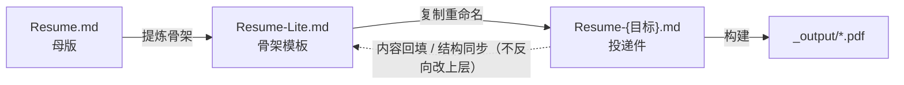

# AGENTS.md

> 此文件为AI协作规则，人工修改前请知会主Agent

本仓库是**基于 Git 的版本化简历与成果管理体系**。参与维护的 Agent 与人工操作，均须遵守本文件。

## 1. 文件职责与三层关系

| 文件 | 角色 | 约束 |
|---|---|---|
| `Resume.md` | 母版（唯一事实来源） | 含 7 段完整经历；只读，不直接投递 |
| `Resume-Lite.md` | 只读模板（骨架精简版） | 严禁直接修改；定制时先复制再重命名 |
| `docs/INDEX.md` | 统一索引台账 | 项目成果、子版本简历实例（仅 md）、投递 tag 台账三合一，由 IndexAgent 维护 |



**内容改动只能先在母版发生，再向下同步；禁止反向改写上层文件。**

### 目录职责

| 目录 | 职责 | Git 策略 |
|---|---|---|
| `docs/` | 原始证明材料，按 `横向/纵向/实习/{序号}-{项目简称}/` 分类。**不删、不改、不重命名**，丢失不可再生；`其他补充描述/` 存放招聘网站填报用的额外描述素材（简历正文无对应模块）；`LOG.md` 操作日志位于本目录根（见 §3.4）。 | 全部入库 |
| `_output/` | **唯一结果输出目录**，所有 PDF 产物（母版/模板/投递件 PDF）统一存放于此。 | 忽略内容，保留 `.gitkeep` |
| `_temp/` | 中间临时产物与环境依赖；构建脚本 `scripts/` **例外入库**（其余忽略）。 | `_temp/*` 忽略，`scripts/` 例外 |

`.gitignore` 规则 `/*.pdf` 为防御性保留（根目录不应再存放 PDF），勿写成 `*.pdf`（否则误伤 `docs/` 证明材料）。

## 2. 校验优先于信任（强制）

用户会**随时人工介入**本仓库（增删改移文件、git 操作均属常态）。任何上下文记忆都可能过期，因此：

- **操作前校验**：任何读取、分析、修改前，重新获取磁盘真实状态（重新读取文件 / `git status` / 字节数与修改时间），**不以会话上下文中的旧信息为准**——无论该信息多"新"、多"确定"。
- **不一致即停**：校验结果与上下文记忆冲突时，以磁盘为准，向用户说明差异，禁止基于过期记忆继续推理。
- **操作后校验**：写操作完成后复核实际落盘（diff、字节数、路径存在性），与预期一致才可报告完成。
- **引用即比对**：引用文件内容（表格行、路径、数字指标）必须与磁盘原文逐字比对，禁止凭记忆转述。

## 3. 工作流规范

### 3.1 新增项目

1. 在 `docs/` 对应分类下建立 `docs/{横向|纵向|实习}/{序号}-{项目简称}/` 目录，归档原始材料。
2. 在 `docs/INDEX.md` §1 登记该项目性质、起止时间、资料路径（**索引先行**）。
3. 依据索引条目，更新母版 `Resume.md` 对应章节的完整经历描述。
4. 评估项目分量：若属核心成果，同步 Lite 版骨架（同步的是**结构**，非全部内容）。

### 3.2 定制投递版简历

1. **复制** `Resume-Lite.md`，重命名为 `Resume-{目标}.md`（如 `Resume-ByteDance.md`）。禁止直接改动模板。
2. 打开新文件，基于母版 `Resume.md` 的内容替换骨架条目，按目标岗位裁剪详略。
3. 用 `_temp/scripts/build-pdf.sh` 生成 PDF，输出至 `_output/`（如 `_output/Resume-ByteDance.pdf`）。
4. 在 `docs/INDEX.md` §2 登记该实例（只记 md 源文件，PDF 产物不入账），提交 `build(resume): 生成 ByteDance 投递版 PDF`。
5. **投递前必打 tag**：`git tag v{版本}-{目标}-{YYYYMMDD}`，并在 `docs/INDEX.md` §3 台账登记（格式与细则见该节）。

### 3.3 母版更新后的同步

1. 改动只落在 `Resume.md`，提交为 `docs(resume): ...`。
2. 评估 `Resume-Lite.md` 是否需同步——**同步的是结构（章节、条目顺序、骨架位置），而非全部正文内容**，Lite 版保持精简。
3. 若需同步，由 EditAgent 提出改动点，确认后修改 Lite 版并提交 `docs(lite): ...`。
4. 检查已有 `Resume-{目标}.md` 投递件是否受影响，必要时重建 PDF 并重打 tag（小版本递增）。

### 3.4 操作日志

- 对仓库结构或材料的**重大操作**（重命名、移动、删除、目录调整、批量修改），操作者须在 `docs/LOG.md` 登记：日期时间、操作者、操作、涉及路径、备注。人工与 Agent 均适用。
- 日常文字编辑不必逐条登记，按 §4 提交 commit 即可追溯。

## 4. Git 规范

### 4.1 Commit 格式

```
type(scope): subject
```

| type | 用途 | 示例 |
|---|---|---|
| `docs` | 简历正文内容改动 | `docs(resume): 补充省自然科学基金课题的算法职责描述` |
| `data` | `docs/` 原始材料增删 | `data(横向): 归档南方电网 RPA 项目验收报告扫描件` |
| `index` | `docs/INDEX.md` 索引台账 | `index: 新增机场物流二期项目条目及资料路径` |
| `rule` | 规则文档与配置 | `rule: 建立 AGENTS.md 协作规则与 .gitignore 策略` |
| `build` | 生成 PDF 产物 | `build(resume): 生成 v1.1 ByteDance 投递版 PDF` |
| `chore` | 其他杂项 | `chore: 清理 _output 下过期投递件` |

### 4.2 Tag 规范

Tag 是"哪版投了哪家"的追溯机制：每次实际投递前**必须**打投递快照 tag 并在台账登记；格式定义、版本号细则与台账见 [`docs/INDEX.md`](docs/INDEX.md) §3。

### 4.3 默认提交义务

- Agent 完成任何文件写入/修改后，**默认执行** `git add <本次改动文件>` + `git commit`，message 按 §4.1 规范自适应生成。
- **提交边界**：只提交本次任务产生的改动；用户自己的未提交变更（历史遗留的 `M`/`D`）一律不碰、不代提交。
- **免提交例外**：用户明确说"先不提交"；方案待确认阶段；改动未通过自检。
- **失败必须上报**：commit 因权限、身份配置（user.name/email）、钩子拦截等原因失败时，**明确报告原因**——不得静默跳过，不得假装已提交。
- 默认不 `push`，除非用户明确要求。

## 5. 多 Agent 协作指引

后续维护按 5 个角色分工，各角色只改职责范围内的文件：

| 角色 | 职责 | 输出物 |
|---|---|---|
| ScanAgent | 扫描 `docs/` 与仓库现状，识别新增/变更材料 | 扫描报告、待办清单 |
| IndexAgent | 构建与维护 `docs/INDEX.md` 索引台账 | `docs/INDEX.md` |
| DocAgent | 文档工程：规则、模板、产出流程 | `AGENTS.md` |
| EditAgent | 母版与 Lite 版的编辑、校对、润色 | `Resume.md`、`Resume-Lite.md` |
| AuditAgent | 整合审计：一致性校验、索引与正文对账 | 审计报告、修正建议 |

- **写权限隔离**：任一文件只有一个责任 Agent，其他 Agent 需改动时提交建议。

## 6. 路径与编码约定

- 文档内文件路径分隔符统一用 `/`，不使用反斜杠。
- 流程、派生关系等图表优先用 mermaid 或 markdown 表格表达，不使用 ASCII 字符画。
- 文件统一 UTF-8 无 BOM 编码。
- 本文件是 `所有本地agent软件（Trae\ WorkBuddy\ 等）` 项目上下文注入文件，**总字符数须控制在 8000 以内**，增补时保持精简。
