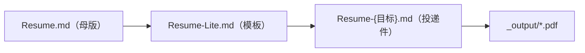

# Resume

版本化简历管理仓库 —— 以 Git 追踪简历的每一次改动与投递，让"哪版投了哪家"永久可追溯。

## 核心文件

| 文件 | 说明 |
|---|---|
| `Resume.md` | 简历母版，唯一事实来源，含 7 段完整经历，只读不直接投递。 |
| `Resume-Lite.md` | 骨架式精简模板，只读；定制时复制后重命名为 `Resume-{目标}.md`。 |
| `Projects-Index.md` | 成果索引表，登记各项目的性质、时间与证明材料路径。 |
| `AGENTS.md` | AI 与人工协作规则：文件职责、工作流、Git commit/tag 规范、多 Agent 分工。 |

## 目录

- `docs/` —— 原始证明材料与操作日志 `LOG.md`，材料按 `横向/纵向/实习/{序号}-{项目简称}/` 分类，不删不改不重命名，全部入库。
- `_output/` —— 唯一结果输出目录，存放生成的 PDF 投递件，被 `.gitignore` 忽略。
- `_temp/` —— 中间临时产物与环境依赖（含构建脚本 `_temp/scripts/`），不入库。

## 三层派生关系

内容改动只能先在母版发生，再向下同步结构，禁止反向直接改写上层文件。

---

> **详细规则请查看 [`AGENTS.md`](./AGENTS.md)**：新增项目流程、定制投递流程、commit 与 tag 规范、5 个 Agent 角色分工，全部在其中。修改本仓库前请先阅读。
