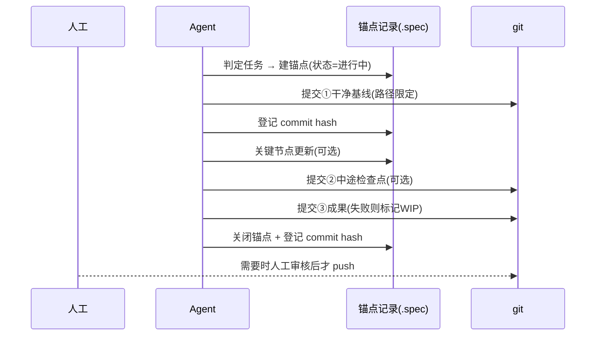

# Git 版本管理控制机制 —— 设计思路与分析记录

> 生成时间：2026-09-14 15:56
> 裁决时间：2026-09-14 22:29
> 性质：**方案计划内容**——文中歧义与待裁决项已按推荐方案裁决并逐处标识（标识形式：`【已裁决·推荐方案】`）；如后续发现不当，再定向修正
> 关联：`_temp/current/agent 规约体系构建设计.md` §4.7（任务执行锚点机制）
> 落点（已裁决 C-1）：主设计稿 §4 新增「§4.8 Git 提交追踪机制」；`AGENTS.md` 第 6 类「维护与校验」挂规定、第 2 类「核心规则」补格式细则；§5.1 流程插入 git 节点、§5.4 纳入 GV 校验项

---

## 1. 用户原始设想

新增「git 版本管理控制机制」，配合「任务执行锚点机制」来辅助 Agent 规约管理项目仓库，引导约束 Agent 行为使其操作与结果符合预期。要点：

1. 每当锚点机制判定并确认了一个任务锚点，**任务执行前与完成后至少各做一次 git 提交**
2. 即使处于非任务状态，在有需要时（Agent 判定后经人工确认，或人工显式要求）也应提交
3. 预期效果：所有任务锚点与 git 提交记录串联成一份**完整可靠的日志**，并保证一旦出错可**完整回滚溯源**，不产生不可逆损害

## 2. 分析结论

**方向合理，可作为机制骨架成立**——用任务锚点给 git 提交「打桩」，使**任务语义**与**版本快照**互相对应，是 Agent 场景下可追溯性的标准解法。

合理性三点依据（与本设计稿现有条款天然接驳）：

| # | 依据 | 落点 |
|---|------|------|
| 1 | 触发点齐备，无需新建节奏 | `Project-Spec-build.md` §8.5 已定义四个节点：任务开始 / 关键节点 / 任务结束 / 重启继续 |
| 2 | 归属已有，不必另开章节体系 | 主设计稿 §3.4 第 2 项「核心规则」已含**分支策略、提交规范**；§2.4 已将「Git 提交消息格式」判为**约束层** |
| 3 | 「哪些进库」已有一半答案 | §3.2 规定 `.spec/` **严禁**入 `.gitignore`；§4.6 规定 `_temp/` **必须**入 `.gitignore`（两者相反） |

## 3. 需补强的 5 处薄弱点

| # | 薄弱点 | 问题实质 | 实测证据 |
|---|--------|----------|----------|
| 1 | 「锚点 ↔ 提交」缺双向绑定 | 只提交不登记 commit hash，日志仍是两套孤立记录，「连起来」不成立 | 现有锚点层字段仅状态/时间/摘要/详情索引，**无 commit 字段**（§4.7.3） |
| 2 | 脏工作区策略未定义 | 任务前提交会裹入在途未提交变更，反而破坏回滚边界 | 2026-09-13 本仓库：主稿存在人工未提交修改，Agent 因此**主动选择不提交**——目前靠隐性默契，非条款 |
| 3 | 「不可逆损害」不自动被覆盖 | git 只保护**已跟踪**文件；删除未跟踪文件、行尾噪声、破坏性命令均为盲区 | 2026-09-14 清理的 44 个文件中相当部分为未跟踪状态；且本仓库 `core.autocrlf=true` 无 `.gitattributes`，checkout 时 LF→CRLF 制造「全文改动」假差异 |
| 4 | 失败/中断/长任务的提交语义空白 | 「首尾各一次」遇任务失败或跨天中断时，要么提交半成品污染历史，要么整段工作无保护 | — |
| 5 | 多 Agent 并发提交无权限规则 | 构建流程存在 A~F 多角色并行（`Project-Spec-build` §10.1），并发 `git add/commit` 会 `index.lock` 冲突、互相裹挟变更 | — |

**现实反例（建议写入格式条款）**：本仓库历史提交中「update」重复出现 10 次，此类消息无法构成可用日志，说明**格式必须强制**，不能仅靠习惯。

## 4. 细化方向（8 个维度）

### 维度 1：触发时机
- 锚点四节点各一次：任务开始前 = **干净基线提交**；任务结束时 = **成果提交**；关键节点 = **中途检查点提交**`【已裁决·推荐方案 C-3：可选，非强制】`
- 非任务态提交须同时满足三条件：有内容变更 + 有语义价值 + 非中间态，且经人工确认或人工显式要求
- **双向绑定**`【已裁决·推荐方案 C-5：采用】`：每次提交后，将 commit hash 登记至锚点层与详情层——锚点层「当前任务锚点」新增字段 **`关联提交`**（可多值，按时间顺序列出本任务全部 commit hash）；详情层在对应节点记录同一 hash

### 维度 2：提交范围
- 必须**路径限定**，只提交本次任务涉及路径
- 不得 `git add -A` 裹挟无关变更
- 检测到在途的他人/人工未提交变更时，**默认不提交并上报**，由人工裁决

### 维度 3：消息格式
- 强制模板：`<类型>(<任务锚点ID>): <一句话摘要>`，正文列关联文件与验证结果
- 类型沿用现有约定（chore / docs / feat / fix）

### 维度 4：回滚语义
- 只允许 `revert` 或「新建修复提交」
- **禁止** `reset --hard`、`rebase -i`、`push --force`、`filter-branch`、`gc --prune`
- 回滚前必须先在任务记录中登记目标 commit

### 维度 5：权限与并发
- `【已裁决·推荐方案 C-2：提交权归「任务执行 Agent / 主协调者」】`
  - 单 Agent 场景：由当前任务的执行 Agent 持有唯一提交权
  - 多 Agent 场景：提交权**收归主协调者（F 协调员）**，其余角色（A 扫描员 / B 分析师 / C 架构师 / D 撰写员 / E 校验员）只产出文件、**不得执行提交**
  - E 校验员**不持有**提交权（校验与提交分离，避免自证）
- 提交前检查 `index.lock` 残留；检测到残留即中止提交并上报，不得强制删除锁文件

### 维度 6：失败与例外
- `【已裁决·推荐方案 C-4：允许提交并标记 WIP】`任务失败/中断：允许提交，但**必须**在消息与锚点状态中标记 `WIP/中断`，并记录已完成边界；恢复时以该 WIP 提交为起点，经「读→比→确认」后续接（对齐 §4.7.2 重启/继续规则）
- 删除未跟踪文件前**强制先备份或先纳管**（2026-09-14 清理即先打包 zip 再删）

### 维度 7：校验条款
- `【已裁决·推荐方案 C-6：纳入 §5.4 全局校验流程】`新增检查项（对齐现有 `TA-01/TA-02` 风格，编号 `GV-01…`）：
  - GV-01 已关闭任务锚点在锚点层「关联提交」字段中至少登记 1 个 commit hash
  - GV-02 该 commit 的 message 含任务锚点 ID
  - GV-03 受控目录（`.spec/` 及实例层登记文档）无未跟踪交付物
  - GV-04 任务记录中无破坏性命令使用痕迹（reset --hard / rebase -i / push --force / filter-branch / gc --prune）
  - GV-05 工作区无残留 `index.lock`

### 维度 8：行尾一致性要求
- `【已裁决·推荐方案 C-7：采用条件触发条款】`当目标项目满足**任一**条件时，必须提供 `.gitattributes` 固定行尾：① 存在跨平台（Windows/Linux/macOS）协作；② `core.autocrlf` 为 `true`
- 条款内容：显式声明文本文件行尾策略（如 `* text=auto eol=lf`），禁止依赖 `core.autocrlf` 隐式转换
- 理由（实证）：本仓库 `core.autocrlf=true` 且无 `.gitattributes`，checkout 时将工作区 LF 展开为 CRLF，会造成「全文改动」的假差异，破坏「提交 = 可审阅快照」这一前提

## 5. 三条红线

1. **默认不 push**——提交是本地快照，push 属对外动作，须人工确认（与本仓库现约定一致）
2. **不代提交在途变更**——宁愿少提交并上报冲突，也不把他人未完成工作裹进快照
3. **删除前必备份**——git 保护不到未跟踪文件，删除动作必须前置备份或纳管

## 6. 与任务锚点机制的配合流程

## 7. 裁决记录（2026-09-14 22:29）

> 原「待人工审核确认项 C-1~C-7」已按推荐方案逐项裁决，全部标识为 `【已裁决·推荐方案】`；如后续发现不当，定向修正对应维度即可。

| # | 事项 | 裁决结果 | 影响位置 |
|---|------|----------|----------|
| C-1 | 机制编号与落点 | **主设计稿 §4.8「Git 提交追踪机制」**（不新增一级章节，只嵌入式扩展） | 文档头落点行、§4 全文 |
| C-2 | 提交权归属 | **任务执行 Agent / 主协调者**；多 Agent 场景收归 F 协调者；E 校验员不持有（校验与提交分离） | §4 维度 5 |
| C-3 | 关键节点检查点提交 | **可选**（非强制），由 Agent 判定必要性 | §4 维度 1 |
| C-4 | 失败任务是否允许提交 | **允许**，但必须在消息与锚点状态标记 `WIP/中断` 并记录已完成边界 | §4 维度 6 |
| C-5 | 锚点层新增 commit hash 字段 | **新增**：锚点层「当前任务锚点」增加 `关联提交` 字段，实现锚点 ↔ 提交双向绑定 | §4 维度 1 |
| C-6 | GV 系列校验项是否纳入 §5.4 | **纳入**，定义 GV-01~GV-05 五项 | §4 维度 7 |
| C-7 | `.gitattributes` 行尾条款 | **采用条件触发条款**：跨平台协作或 `core.autocrlf=true` 时强制 | §4 维度 8 |

## 8. 状态

- **当前**：`C-1~C-7` 已按推荐方案裁决（见 §7），本文**作为方案计划内容生效**（详见文档头「性质」行）
- **后续**：可据此将 §4 的 8 个维度写成主设计稿 §4.8 正式条款，并同步更新 §5.1 流程与 §5.4 校验；届时本文转为依据存档
- **边界**：截至本次裁决，**主设计稿未改动任何内容**；正式条款的写入须另行下达指令
- **修正入口**：如任一裁决不当，直接指出 `C-x` 编号 + 期望结果，本文对应维度可定向修改
