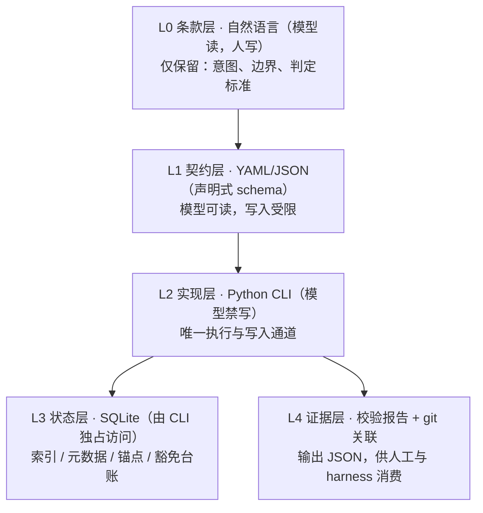

# 规约体系代码化过渡方案 —— harness 化设计思路与分析

> 生成时间：2026-09-15 11:07
> 性质：**待人工审核的设计思路记录**（非正式条款；审核通过后才转入主设计稿或作为本仓库自身演进方案）
> 关联：`_temp/current/agent 规约体系构建设计.md`（本方案讨论该设计稿所描述体系的下一阶段形态）
> 编号约定：本文件待裁决项使用 `H-xx` 前缀，与已定稿的 Git 机制裁决项 `C-1~C-7` 及既有校验编号（M/L/P/TA/GV 系列）**互不冲突**
> 建议落点（待裁决 H-01）：① 主设计稿 §6「其他要求」新增一节「实现层可下沉清单与降级要求」；② 作为**本仓库自身**由 `prompts/` 提示词体系向代码化演进的独立路线

---

## 1. 用户原始设想

本 agent 规约体系是**提示词工程 → harness 的中间态**：

1. **主体仍以文档（本质是提示词）形式存在**——既能验证理念设计，也便于修改调整
2. **但全提示词体系是对 LLM 上下文的不必要占用**；部分重复性、标准性工作应由 `Python 脚本 + SQLite 数据库 + 表格文件 + 参数文件` 替代
   - Python：对 AI 最友好、便于编写与运行
   - SQLite：存储维护关键索引与元数据，避免因上下文幻觉导致异常，也避免 markdown 文档在 Agent 直接维护过程中因幻觉导致内容异常
   - 表格/参数文件：可为 markdown 或 JSON/YAML，便于 Agent 读取；但**操作必须通过 Python 脚本**，以保证一致性、完整性、准确性
3. **通过权限设置使 Agent 无权操作**：Windows 设只读，Linux 设仅 root 可操作，保证不误操作
4. **为未来迭代为 skill / plugin 乃至 harness 框架的一部分奠定基础**——因为其本身就是代码、数据库、JSON 参数文件等标准化实现

## 2. 分析结论

**方向合理，且与本仓库已有证据链吻合**；但需先校正 4 个前提（见第 3 节），否则成品会出现「假安全 + 双写漂移 + 不可移植」三重问题。

### 2.1 与 harness 组件槽位一一对应

harness 的常见构成 ≈ model + 上下文装配 + 工具集 + 权限沙箱 + 状态持久化 + 验证器 + 可观测性。

| 用户方案 | 对应 harness 槽位 | 本仓库当前形态 |
|---|---|---|
| 文档条款（提示词） | 上下文装配 | ✅ 已有（`prompts/` 7 文件） |
| YAML/JSON 参数、表格文件 | 工具输入契约 | ⚠️ 部分有（YAML front matter、`INDEX.md`） |
| Python 脚本 | 工具集 / 验证器 | ❌ 缺失（校验靠 LLM 逐条读文档执行） |
| SQLite | 状态持久化 | ❌ 缺失（索引与元数据靠 md 手工维护） |
| 只读 / 权限控制 | 权限沙箱 | ❌ 缺失 |
| 校验报告 / 日志 | 可观测性 | ⚠️ 仅有散落的 md 报告 |

### 2.2 本仓库实证：待下沉的规则天然是机器可判定的

- `prompts/Project-Spec-check.md` 已有 **M / L / P / TA 四个检查系列**（如 M-02 必填字段、M-03 枚举值校验、P-01 文件存在性检查），加主设计稿新增的 **GV-01~GV-05**——这些「逐字段检查 / 值校验 / 文件存在性检查」以自然语言书写，本质是在**用 token 描述一次正则匹配或一次 `os.path.exists`**
- 效率实证：本仓库 41 篇文档断链扫描，纯 grep 管道版产出约 150 条伪命中并因超时被 SIGTERM，Python 版（按文件所在目录解析相对路径）**秒级完成、仅 1 条真命中**
- 缺口实证：主设计稿 §4.7.8「校验先于信任——重启时必须读→比→确认」目前完全靠人工比对；**文档内容 hash 存库后即可自动判定「记录与实物是否一致」**，这是最值得代码化的高价值点

### 2.3 模型侧必然性

上下文是稀缺资源，确定性规则以自然语言反复注入，既**每轮重复支付 token**，又**无法保证执行结果一致**（同一条规则，不同会话可能被不同理解或遗漏）。

## 3. 必须校正的 4 个前提

| # | 原设想 | 问题实质 | 校正方向 |
|---|--------|----------|----------|
| 1 | 「设为只读 → Agent 无权操作」 | **同账户下只读不是安全边界**：Windows 只读属性可被同账户取消，NTFS ACL 亦可改回；Linux「仅 root」仅在 Agent 非 root 时有效，sudo 与容器挂载可绕过。真实隔离需**不同身份 / 只读挂载 / 容器** | 定位为「**防误操作护栏**」而非防越权；并优先采用「**受控写入通道**」——不追求全面只读，而是规定 Agent 只能经 CLI 写（如 `spec-cli index add`），禁止直接改 md / DB |
| 2 | 「SQLite 防幻觉」 | DB 只保证**结构不漂移、引用完整、事务原子**，不保证**内容正确**；且 md 与 DB 若都可写，必然双写不一致 | 明确**唯一真相源**：DB 持索引与元数据、md 持长文本，二者以 ID 关联；md 内的索引区块改为**脚本生成物**（标记为生成、禁止手改） |
| 3 | DB 入库版本控制 | SQLite 是二进制，git 无法有效 diff / 合并 | DB 定位为**可重建派生物**（源＝YAML/JSON + md，脚本重建）；或入库同时提供 `sqlite3 .dump` 文本快照供审阅 |
| 4 | 全面代码化 | 目标项目可能是任意仓库，未必有 Python、未必可联网 | 保留**降级模式**：无脚本时体系仍须可用（否则违反主设计稿 §1.3 终审判据第 1 条「仅凭 `AGENTS.md` 即可重建上下文」）；脚本是增强项，**不是依赖项** |

## 4. 细化方向

### 4.1 四层分层架构（文档变薄、实现变厚，条款与实现分离）

### 4.2 下沉判据（三分法，避免「什么都想代码化」）

| 类别 | 处理方式 | 典型条目 |
|------|----------|----------|
| 机器可判定 | **下沉到代码**，结果即结论 | 元信息 schema、链接完整性、INDEX 同步、文件命名格式、提交合规（GV）、生命周期 30 天计时 |
| 机器可辅助 | 代码产出证据 + LLM 裁决 | 层级归属判定、内容重复度（相似度候选 → 模型定夺）、锚点记录与实物一致性 |
| 纯意图 / 文化 | 留在条款层 | 审查要求、分支策略意图、豁免正当性、设计原则表述 |

### 4.3 建议优先下沉清单（按收益/成本排序）

| 序 | 工具 | 职责 | 对应现有条款 |
|----|------|------|-------------|
| 1 | `validate.py` | 元信息七字段 + 枚举 + 命名格式校验 | 主设计稿 §4.2、check 的 M 系列 |
| 2 | `check.py` | 链接完整性 + INDEX 同步 + 孤立文档检测 | §4.5 七项校验、L 系列 |
| 3 | `anchor.py` | 锚点状态机 + commit hash 双向绑定登记 + GV-01~05 | §4.7、§4.8.7 |
| 4 | `render.py` | 由 DB 生成 `INDEX` 区块与任务看板（消灭手写索引漂移） | §3.3、§5.2 |
| 5 | `hash.py` | 文档指纹存库，自动实现「读→比→确认」 | §4.7.8 |

### 4.4 接口先行（为 skill / plugin / harness 铺路）

- 先冻结 **CLI 契约**：命令集、参数 schema、`--json` 输出、**退出码约定**（0 通过 / 1 校验失败 / 2 用法错误）
- skill 化 = 把该 CLI 包装为动作 + 把条款包装为 references；**没有稳定接口，未来的 skill 只是另一次重写**

### 4.5 补上 harness 缺失的一环：评测

- 建议把**本仓库实际暴露过的缺陷直接沉淀为 golden cases**：`.trae/documents` 未跟踪、INDEX 与实际漂移、CRLF 假差异、幽灵链接、未提交的设计稿
- 用例形式：故意注入缺陷 → 断言校验器报错（阴性 + 阳性双向用例）

### 4.6 渐进路径（每步独立获益，不必一次到位）

1. **只读校验器**——不改体系，纯收益，可立即实施
2. **生成器**——自动生成索引与看板，消灭手工维护漂移
3. **状态迁入 SQLite**——锚点 / 豁免 / 索引三类状态落库
4. **接口封装为 skill / plugin**

### 4.7 下沉判断门槛

- 某动作在一个季度内**重复多次**，或**出错代价高**（索引漂移、误删、状态不一致）→ 下沉
- 偶发且低代价 → 不下沉，避免过度工程
- 个人仓库尤须注意：**代码本身也有维护成本**，条款与实现一旦各说各话，反而比全提示词更危险

## 5. 与现有体系条款的衔接点

| 现有条款 | 本方案的作用 |
|----------|-------------|
| §1.3 终态判据第 1 条（仅凭 `AGENTS.md` 重建上下文） | 约束「降级模式」必须成立，脚本不得成为前置依赖 |
| §4.5 七项校验 | 全部为候选下沉项（机器可判定） |
| §4.7.8「校验先于信任」 | 由 `hash.py` 自动实现比对环节 |
| §4.8 Git 提交追踪（GV-01~05） | 天然的脚本化对象（解析 `git log` + 工作区状态即可） |
| §6.1 设计原则「机器可读优先」「显式优于隐式」 | 本方案是其自然延伸，但须补充**区隔**：`机器可读`（声明式契约）≠ `机器执行`（实现层） |

## 6. 风险清单

| # | 风险 | 处置方向 |
|---|------|----------|
| 1 | 双实现漂移：条款与脚本各说各话 | 条款只写**判定标准**，不写实现细节；实现变更须同步条款（或条款指向实现为唯一真相源） |
| 2 | 假安全：同账户只读被误当安全边界 | 明确定位为护栏；敏感写入走 CLI 通道 |
| 3 | 环境依赖：目标项目无 Python / 无网 | 强制降级模式；CLI 失败不得阻塞体系可用 |
| 4 | DB 二进制入库破坏 diff | DB 视为派生物，或提供 dump 文本快照 |
| 5 | 过度工程：为低频动作付出长期维护成本 | 依 4.7 门槛逐项评估 |
| 6 | 权限配置本身成为故障源（误设导致人工都改不了） | 提供**恢复路径**：权限调整须留可逆步骤并写入 README |

## 7. 待裁决项（H 系列）

| # | 事项 | 推荐方案 |
|---|------|----------|
| H-01 | 落点：写入主设计稿 / 作为本仓库自身演进方案 | （说明：与 prompt 本体同类，属本仓库自身演进 → **作为独立演进路线**） |
| H-02 | 是否将「实现层可下沉清单」写入主设计稿 §6 | 建议**写入**，但仅写「可下沉清单 + 降级要求」，不写具体实现 |
| H-03 | 真相源划分 | **DB 持索引与元数据，md 持长文本，ID 关联；md 索引区块为生成物禁止手改** |
| H-04 | DB 是否入库 | **视为可重建派生物，不入库**；另存 `sqlite3 .dump` 文本快照供审阅 |
| H-05 | 权限模型 | **受控写入通道（CLI 唯一写入口）为主，只读属性为辅**，明确定位为防误操作护栏 |
| H-06 | CLI 契约是否先行冻结 | **先行冻结**（命令集 + `--json` + 退出码），作为后续 skill 化前提 |
| H-07 | 是否建立 golden cases 评测集 | **建立**，首批用例取自本仓库真实缺陷 |
| H-08 | 实施顺序 | **只读校验器 → 生成器 → DB 状态层 → skill 封装**（渐进，每步独立获益） |
| H-09 | Python 运行环境约定 | 建议统一使用 runtime 内隔离环境（venv），不污染用户环境；具体路径待定 |

## 8. 状态

- **当前**：思路已分析并记录，等待人工审核
- **下一步**：人工裁决 H-01~H-09 后，将确定的部分转为正式条款或独立演进方案；未裁决项不实施
- **未执行**：本次仅落盘方案文档，**未改动主设计稿、未新增任何脚本或数据库、未调整任何文件权限**
